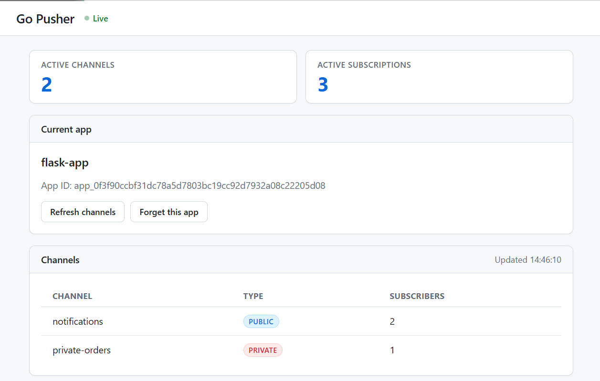

# Go Pusher

A small **Pusher-style** service built with Go, WebSockets, and SQLite. The Go
service registers apps and routes events by app and channel. 



For app developers, see the [Usage Guide](docs/usage.md) for publishing events and
subscribing to public, private, and presence channels.

## Run Go

```sh
export CHANNEL_AUTH_SIGNING_KEY="replace-with-a-long-random-signing-key"
go run .
```

Open <http://localhost:8080> and register an app. Keep its credentials private.

App records are stored in `data/pusher.db` by default; set `PUSHER_DB_PATH` to
change the location. **Keep this database and its backups private.**

## Run with Docker

Build and run the Go service with a persistent volume for its SQLite database:

```sh
docker build -t go-pusher .
docker run --rm -p 8080:8080 -v go-pusher-data:/data go-pusher
```

Open <http://localhost:8080>. The Flask client is not included in the image.

## Demo Client: Flask (Optional)

This Flask app is provided as a working example, not a requirement for using Go
Pusher. Your own backend can publish events and request private/presence channel
authorization in any language (Ruby, PHP, ...). 
Keep `APP_SECRET` on the backend; never expose it
to browser code.

In a second terminal, set up the client's environment:

```sh
cd clients/flask_app
cp .env.example .env
```

Put the credentials from the Go registration page in `.env`. Then install and
run Flask:

```sh
python3 -m pip install flask requests
set -a
. ./.env
set +a
python3 app.py
```

Open <http://localhost:5000> for **public channels**. Use the **Go to private
channel** link to reach the login page, then Flask redirects authenticated users
to the protected private-channel page. Flask stores users in its local SQLite
database, checks the session, and asks Go for a short-lived authorization. The
`APP_SECRET` is used server-to-server and is not sent to the browser.


## API

- `POST /apps` registers an app: `{ "name": "My App" }`.
- `POST /apps/{app_id}/events` publishes an event. Your backend sends the app
  secret as a bearer credential; the JSON body contains `event`, `topic`, and
  `payload`.
- `GET /apps/{app_id}/ws?key={app_key}` opens an app's WebSocket connection.
- `POST /apps/{app_id}/private-channel-auth` issues a short-lived grant after
  your backend proves it knows the app secret and provides an active socket ID.

See [usage.md](docs/usage.md) for request examples and browser subscribe flows.
