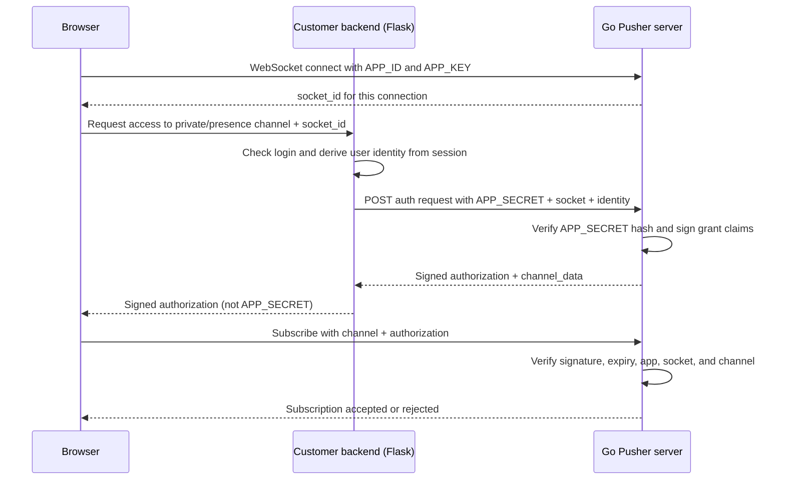

# Private and Presence Channel Authentication

The Go server now issues short-lived JWT
grants for private and presence channels. Presence grants bind a server-derived
user identity to the app, socket, and channel. Production user permissions and
grant revocation are still future work.

This guide explains both flows. Presence builds on private-channel
authorization, then adds member identity and membership events.

## The Basic Idea

An app key identifies an app. It does **not** prove that a particular user is
allowed to read a channel. For a private channel, the customer's backend must
check the signed-in user's permission before Go accepts the subscription.

The browser never receives the app secret. Flask checks the user session and
asks Go to issue a short-lived authorization. For presence, Flask derives
`user_id` and `user_info` from its authenticated session/database. Go validates
Flask's app secret using its stored hash, then signs the identity into a grant
using a separate Go-only signing key.



The signed grant is not itself proof that the user logged in. Go trusts Flask to
make that decision because Flask authenticated with the app secret. Never put
that secret in browser JavaScript, HTML, or a URL.

## How the Grant Is Verified

When a browser sends:

```json
{
  "action": "subscribe",
  "channel": "presence-room-1",
  "auth": "signed-grant"
}
```

Go performs these checks:

1. The channel starts with `private-` or `presence-`.
2. The JWT uses the expected `HS256` algorithm.
3. The signature matches `CHANNEL_AUTH_SIGNING_KEY`.
4. The issuer is `go-pusher`.
5. The token is not expired.
6. `app_id` matches the WebSocket app.
7. `socket_id` matches the current connection's socket ID.
8. `channel` matches the requested channel exactly.
9. For `presence-*`, the signed claim has a non-empty `channel_data.user_id`.

Only after all checks pass does the hub add the client to the channel. A failed
check produces a subscription error and does not add the client.

## Private-Channel Flow

### 1. Open a WebSocket

The browser connects to the existing endpoint with the public app credentials:

```text
GET /apps/{app_id}/ws?key={app_key}
```

Go generates a random `socket_id` for each connection and sends it to the
browser in a connection-established message. The socket ID identifies this
particular live connection; it is not a user ID or a secret.

### 2. Ask Flask to authorize the user

When the user wants to subscribe to `private-orders`, the browser calls the
Flask route:

```text
POST /api/private-channel-auth
```

The request includes the `socket_id` and channel. The browser's normal Flask
session cookie identifies the signed-in user. Flask must check both that the
user is logged in and that they are allowed to access that channel. If not, it
returns `401 Unauthorized` or `403 Forbidden` and does not ask Go for a grant.
Because the route authenticates with a session cookie, protect it against CSRF.

The app secret is configured in Flask's environment. The route uses it in a
server-to-server request to Go; it does not accept a secret from the browser.

### 3. Have Go issue a signed grant

A proposed Go endpoint is:

```text
POST /apps/{app_id}/private-channel-auth
Authorization: Bearer {APP_SECRET}
Content-Type: application/json

{
  "socket_id": "socket-unique-id",
  "channel": "private-orders"
}
```

Go should:

- Check the app secret with `Registry.HasSecret`.
- Require a `private-` channel name and a non-empty socket ID.
- Verify that the socket ID belongs to a currently connected socket for this app.
- Sign claims containing `app_id`, `socket_id`, `channel`, and `exp` (expiry).
- Return the signed grant to Flask, which passes it to the browser.

Use a maintained JWT package rather than designing a token format by hand. If
using HMAC JWTs, configure validation to accept only the expected algorithm and
use a dedicated `CHANNEL_AUTH_SIGNING_KEY`; do not reuse an app secret for token
signing. A short lifetime such as 30 seconds limits how long an unused grant can
be replayed.

### 4. Require the grant during subscribe

The browser sends a WebSocket command like:

```json
{
  "action": "subscribe",
  "channel": "private-orders",
  "auth": "signed-grant-from-flask"
}
```

Go verifies the signature and expiry, then checks that the grant's app ID,
socket ID, and channel exactly match the active connection and requested
subscription. Only then should Go add the client to that channel in the hub.
A grant for one socket or channel must not authorize another one.

The grant expiry limits the time to start a subscription. It does not
automatically disconnect a client that was already subscribed. If subscriptions
must expire or be revoked while a socket stays open, Go will also need a lease,
renewal, or explicit revocation mechanism. A grant can also be replayed for the
same socket and channel until it expires. Preventing even that requires a
one-time grant ID and server-side tracking of consumed IDs.

## Presence-Channel Flow

Presence channels use the same authorization endpoint and grant signing key,
but their names begin with `presence-`. The Flask demo derives a stable user ID
from the users table and builds public display metadata from the logged-in
session. It does not accept identity fields from the browser request.

The server-to-server auth request includes:

```json
{
  "socket_id": "socket-unique-id",
  "channel": "presence-room-1",
  "channel_data": {
    "user_id": "42",
    "user_info": {"name": "Ada"}
  }
}
```

The Go response contains both the signed grant and `channel_data`:

```json
{
  "auth": "signed-jwt-grant",
  "channel_data": {
    "user_id": "42",
    "user_info": {"name": "Ada"}
  }
}
```

The `channel_data` identity is also inside the JWT. The browser sends the grant
in its WebSocket subscribe command; Go reads identity from the verified claims,
not from a separate, browser-provided field. `user_info` is limited to 4 KiB of
valid JSON. Put only information that other channel members may see in it.

After verification, the hub performs membership changes in its event loop:

- The joining socket receives `subscription_succeeded` with a snapshot of
  unique members, including itself.
- Existing members receive `member_added` only when this `user_id` was not
  already present.
- If a user has multiple sockets, disconnecting one socket does not remove the
  member. Remaining members receive `member_removed` only after that user's
  final socket disconnects.

The snapshot count represents unique user IDs, while the general dashboard's
subscriber count continues to represent WebSocket connections.

## Configuration

Set `CHANNEL_AUTH_SIGNING_KEY` in the Go environment. This is a long random key
used only by Go to sign grants. Private authorization returns `503` when this
setting is absent; public channels continue to work.

The Flask example uses these settings from `clients/flask_app/.env`:

- `APP_ID`, `APP_KEY`, and `APP_SECRET` identify the registered Go app.
- `FLASK_SECRET_KEY` signs Flask login sessions.
- `USER_DB_PATH` selects the local SQLite database for demo users.

## Manual Test Plan

Run the Go server in terminal 1. The signing key is required for private
channels; use a different random value in a real environment.

```sh
cd /path/to/go-pusher
export CHANNEL_AUTH_SIGNING_KEY="local-test-signing-key-change-me"
go run .
```

### 1. Register an app

Open <http://localhost:8080>, register an app, and copy its **ID**, **key**, and
**secret**. Alternatively:

```sh
curl -X POST http://localhost:8080/apps \
  -H "Content-Type: application/json" \
  -d '{"name":"private-channel-test"}'
```

Keep the returned secret. It is needed by Flask, but must never be pasted into
browser JavaScript or sent in a WebSocket command.

### 2. Configure and run Flask

In terminal 2:

```sh
cd /path/to/go-pusher/clients/flask_app
cp .env.example .env
```

Edit `.env` with the credentials from step 1. Then run:

```sh
python3 -m pip install flask requests
set -a
. ./.env
set +a
python3 app.py
```

Open <http://localhost:5000>. This is the public-channel page. It does not
require login.

### 3. Test user login

1. From the public page, click **Go to private channel**.
2. Confirm Flask redirects you to `/login?next=/private`.
3. Register a user with a password of at least 8 characters.
4. Confirm Flask redirects you to `/private` after registration.
5. Click **Logout**, then open `/private` directly and confirm it redirects to
  `/login` again.
6. Log in again before testing a private channel.

The demo stores users in the SQLite file configured by `USER_DB_PATH`.
Passwords are stored as hashes, not plaintext.

### 4. Test a public channel

Stay on the root page and use channel `notifications`:

1. Click **Connect & subscribe**.
2. The message list should show a connection and subscription.
3. Publish an event from the same page.
4. The subscribed connection should receive the event.

This confirms the existing app-key, WebSocket, publish, and broadcast paths.

### 5. Test an authenticated private channel

After logging in, use the `/private` page and channel `private-orders`:

1. Click **Connect & subscribe**.
2. Go sends a `connected` message containing a `socket_id`.
3. The browser calls Flask's `/api/private-channel-auth` endpoint.
4. Flask checks the session and CSRF token, then calls Go with the app secret.
5. Go returns a short-lived JWT grant and the browser sends it with the
   subscribe command.
6. The message list should show `Subscribed to private-orders`.
7. Publish an event and confirm it is received on the private channel.

The browser may receive the signed grant, but it must not receive `APP_SECRET`.
Inspect the rendered page or browser network responses and confirm the literal
secret is absent.

### 6. Test a presence channel

Open `/private`, set the channel to `presence-room-1`, then connect. The current
user should receive `subscription_succeeded` with `presence.count` and a member
snapshot. Open a second browser profile, register or log in as another user, and
connect to the same channel; the first client should receive `member_added` and
both clients should see two members. Disconnect the second user's final socket;
the first client should receive `member_removed` and return to one member.

Log in as the same user in two browser profiles as an additional check. That
should create two sockets but only one presence member. Closing one profile
should not emit `member_removed`; closing the final profile should.

### 7. Test rejection cases

Check each result:

- Log out and try a `private-*` or `presence-*` channel: Flask should return
  `401 login is required`.
- Remove `X-CSRF-Token` in a request: Flask should return `403 invalid CSRF token`.
- Use a public channel without login: it should still work.
- Stop Go or use an invalid Go URL: Flask should return a connection error,
  not a successful authorization.
- Restart Go without `CHANNEL_AUTH_SIGNING_KEY`: public channels should work,
  but private authorization should return `503`.
- Change the grant's channel or socket ID before sending the subscribe command:
  Go should reject the subscription.
- Wait more than 30 seconds before using a grant: Go should reject the expired
  authorization.

